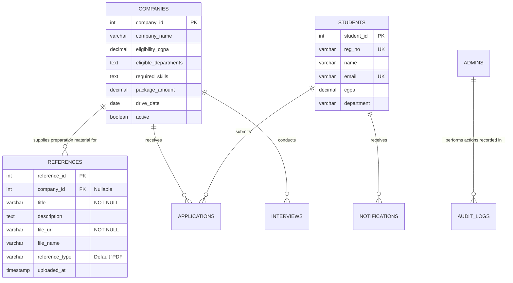
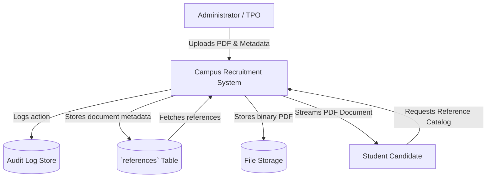
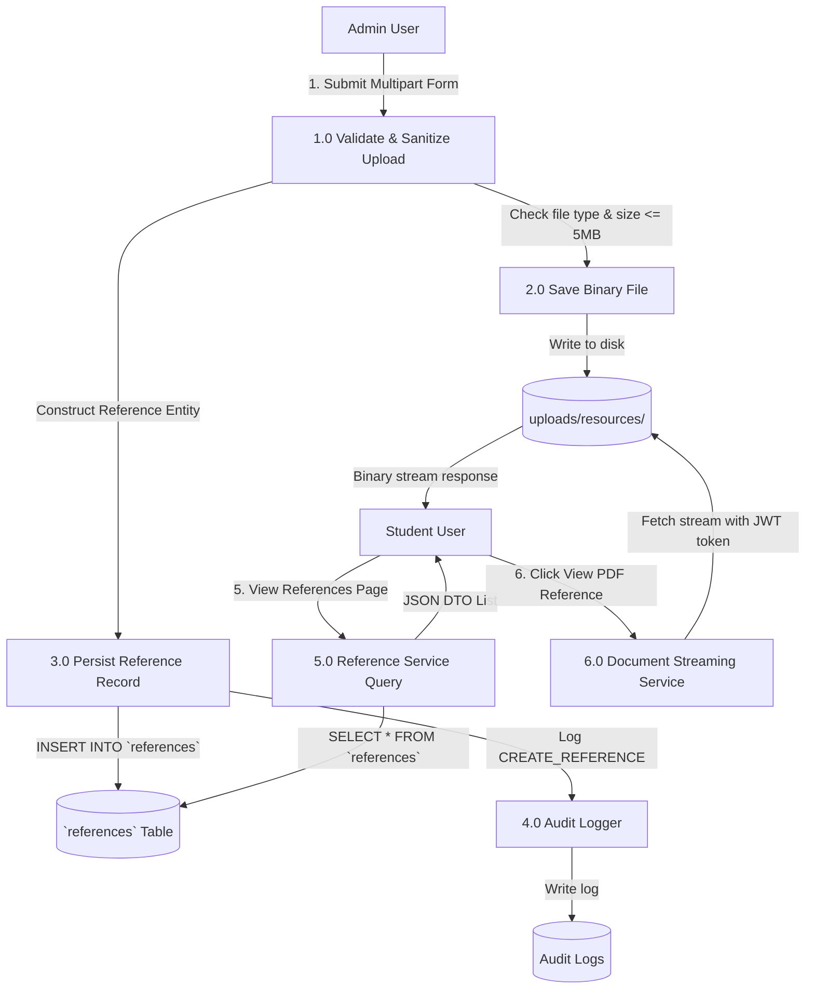
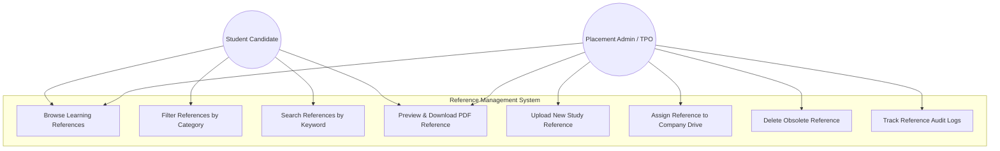
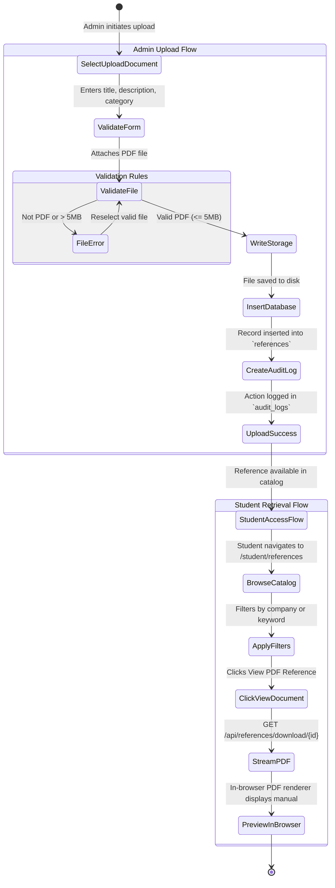

# Architecture & System Design Documentation: Reference Module

This document outlines the architecture, data models, diagrams, and operational specifications for the **Reference** module within the Campus Recruitment System, reflecting the project-wide transition from *Resource* to *Reference*.

---

## 1. Module Descriptions

### 1.1 Student Module: Learning References
*   **Purpose**: Provides candidates with direct access to placement study guides, aptitude question banks, interview blueprint manuals, syllabus blueprints, and company-specific preparation guides.
*   **Features**:
    *   **Reference Library**: Browsable directory of all published preparation materials.
    *   **Categorization & Filters**: Instant multi-criteria filtering by company name or "General / Core Topics".
    *   **Live Search**: Real-time searching across reference titles and topic descriptions.
    *   **Document Preview**: Secure JWT-authenticated inline PDF viewer.
    *   **Reference Details**: Clear visibility of upload timestamps, file types (`PDF`), and associated company tags.

### 1.2 Admin Module: Manage References
*   **Purpose**: Empowers Training and Placement Officers (TPOs) and administrators to curate, upload, categorize, and maintain preparation documents.
*   **Features**:
    *   **Manage References Dashboard**: Centralized management portal listing all documents.
    *   **Reference Upload**: Multi-part upload handler enforcing PDF file validation (max 5 MB) and metadata entry (title, description, optional company affiliation).
    *   **Reference Deletion**: Safe deletion of document metadata from the database and physical removal of files from server storage.
    *   **Audit Logging**: Every reference creation and deletion action is captured in system audit trails.

---

## 2. Database Design (`references` Table)

In MySQL, `REFERENCES` is an SQL reserved keyword; therefore, the table name is safely enclosed with backticks (`` `references` ``) in SQL migrations and JPA mappings (`@Table(name = "\`references\`")`).

### Schema Definition
```sql
CREATE TABLE IF NOT EXISTS `references` (
    reference_id INT AUTO_INCREMENT PRIMARY KEY,
    company_id INT NULL,
    title VARCHAR(200) NOT NULL,
    description TEXT,
    file_url VARCHAR(500) NOT NULL,
    file_name VARCHAR(255),
    reference_type VARCHAR(100) DEFAULT 'PDF',
    uploaded_at TIMESTAMP DEFAULT CURRENT_TIMESTAMP,
    CONSTRAINT fk_references_company FOREIGN KEY (company_id) REFERENCES companies(company_id) ON DELETE SET NULL
);
```

### Backward Compatibility View
```sql
CREATE OR REPLACE VIEW `resources` AS SELECT * FROM `references`;
```

---

## 3. Entity-Relationship (ER) Diagram



---

## 4. Data Flow Diagram (DFD)

### 4.1 Level 0: Context Diagram


### 4.2 Level 1: Reference Module Data Flow


---

## 5. Use Case Diagram



---

## 6. Activity Diagram: Reference Upload & Retrieval


